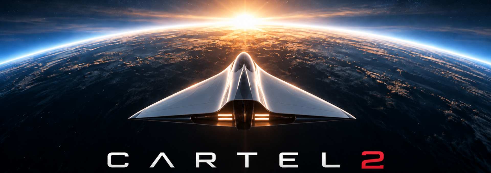

# Cartel 2



**Cartel** is a 2D near-orbit spaceship game for [Godot 4.7+](https://godotengine.org/) (GL Compatibility). Fly with inertia, dock at habitats, trade commodities, outfit ships at the yard, and jump between sectors through Unspace gates.

**Status:** early development - in-game version **DEV**. Gameplay and content are incomplete; see [Project status](#project-status) below.

## Project status

The playable loop is flight, docking, commodity trade, ship fitting, passenger and freight charters, and scan and bounty work. Scan and bounty charters can grant a private volatile translation. Public routes include n=5 and n=6 translations on the same 4-space presentation. There is no separate 5-space or 6-space layout, no hyperdrive translation, and no combat game-over screen.

What is not built: [docs/design/architecture/architecture.md](docs/design/architecture/architecture.md#not-yet-implemented). Open follow-ons: [docs/design/architecture/backlog.md](docs/design/architecture/backlog.md).

## Features

- Newtonian flight, boost, sensors, and orbital navigation
- Habitat hubs: terminal, exchange, shipyard, and building interactions
- Modular ship assembly with catalog-driven parts and engineering budgets
- Commodity trading at habitat Exchanges
- Passenger, freight, scan, and bounty charters
- Save/load to three slots under `user://saves/`

## Requirements

- Godot **4.7.2** or newer (4.7 feature tag, GL Compatibility renderer)
- **Python 3** - optional; used by art/catalog tooling under `scripts/tools/`

Set `GODOT` to your Godot binary if it is not on `PATH`. The CI script defaults to `$HOME/opt/Godot_v4.7.2-stable_linux.x86_64` when `GODOT` is unset.

## Quick start

```bash
git clone <repository-url>
cd cartel2
```

**Editor:** open `project.godot` in Godot and press **F5**.

**CLI:**

```bash
GODOT=/path/to/Godot --path . --editor   # or omit --editor and press F5 in the GUI
```

On **New Game**, choose callsign, portrait, and starting background. The default **Tester** kit begins docked at **Proxima Habitat** with the template fleet.


## Repository layout

| Path | Purpose |
|------|---------|
| `scripts/gameplay/` | Rules and session state (`RefCounted`; no scene tree) |
| `scripts/presentation/` | World loading, ship motion, Godot integration |
| `scripts/ui/` | Menus, HUD, habitat and shipyard screens |
| `data/catalog/` | JSON content (ships, commodities, economies, worlds) |
| `assets/` | Art, fonts, logos |
| `docs/` | Architecture, data model, and setting bible |
| `tests/` | Headless unit tests (custom `TestRunner`, not GUT) |
| `scenes/dev/` | Sandboxes for theme, combat, stealth, and rendering |

Layering and conventions: [docs/design/architecture/architecture.md](docs/design/architecture/architecture.md) and [AGENTS.md](AGENTS.md).

## Development

After changing GDScript or files under `data/catalog/`, run the full verification gate:

```bash
GODOT=/path/to/Godot ./scripts/ci/check.sh
```

The script validates catalogs, imports assets, parses scripts, and runs unit tests. Use `./scripts/ci/check.sh --fast` for a quicker loop (validators + tests only).

**Useful commands** (from repo root, with `GODOT` set):

```bash
# Reimport assets after adding art
$GODOT --path . --headless --import --quit

# Regenerate placeholder location art
python3 scripts/tools/generate_placeholder_art.py

# Rebuild UI theme after token changes
$GODOT --headless --path . --script res://scripts/tools/build_cartel_theme.gd
```

**Dev sandboxes** — open a scene under `scenes/dev/` in the editor and press **F6**, or from repo root:

```bash
./scripts/dev/mission_harness.sh
./scripts/dev/combat_sandbox.sh
# … see docs/design/architecture/dev_sandboxes.md for the full list
```

Override Godot with `GODOT=/path/to/Godot ./scripts/dev/combat_sandbox.sh`. Details: [docs/design/architecture/dev_sandboxes.md](docs/design/architecture/dev_sandboxes.md).

Player portraits: **120×160** PNG (3:4) as `p1.png`, `p2.png`, … in `assets/ui/portraits/` (matches habitat banner height); reimport.

## Documentation

`docs/setting/` is frozen lore: [overview](docs/setting/overview.md) (premise and glossary), [planets](docs/setting/planets.md), [corporations](docs/setting/corporations.md), and the [calendar](docs/setting/date_time.md). Edit those only when a change request names a setting doc.

`docs/design/` is what this repository implements today. Update the doc that states a behaviour in the same change as the code or catalog.

**Architecture** (code layout, schemas, systems, tooling):

- [architecture](docs/design/architecture/architecture.md) - layering, loops, not-yet-implemented list
- [data model](docs/design/architecture/data_model.md) - catalog schemas and runtime types
- [catalog schema](docs/design/architecture/catalog_schema.md) - generated field tables
- [commodity economy](docs/design/architecture/commodity_economy.md) - daily quote equations
- [UI theme](docs/design/architecture/ui_theme.md)
- [sprite sizes](docs/design/architecture/sprite_sizes.md)
- [dev sandboxes](docs/design/architecture/dev_sandboxes.md)
- [backlog](docs/design/architecture/backlog.md) - open work

**Content** (playable rules and rosters):

- [ships](docs/design/content/ships.md), [equipment](docs/design/content/equipment.md), [manufacturers](docs/design/content/manufacturers.txt)
- [commodities](docs/design/content/commodities.md), [trade network](docs/design/content/trade_network.md)
- [translations](docs/design/content/translations.md), [missions](docs/design/content/missions.md)
- [field conditions](docs/design/content/field_conditions.md), [GST in play](docs/design/content/gst.md)

Setting prose is the lore target. Catalog JSON is the current playable subset. Do not invent lore in JSON to fill a gap the frozen setting files do not cover.

## License

Cartel is licensed under the [GNU Affero General Public License v3.0](LICENSE).

IBM Plex Sans and IBM Plex Mono in `assets/ui/fonts/` are under the [SIL Open Font License 1.1](assets/ui/fonts/LICENSE.txt).

