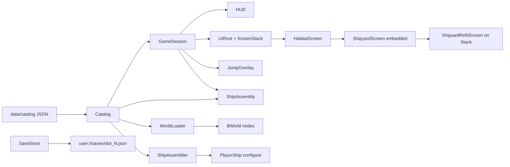
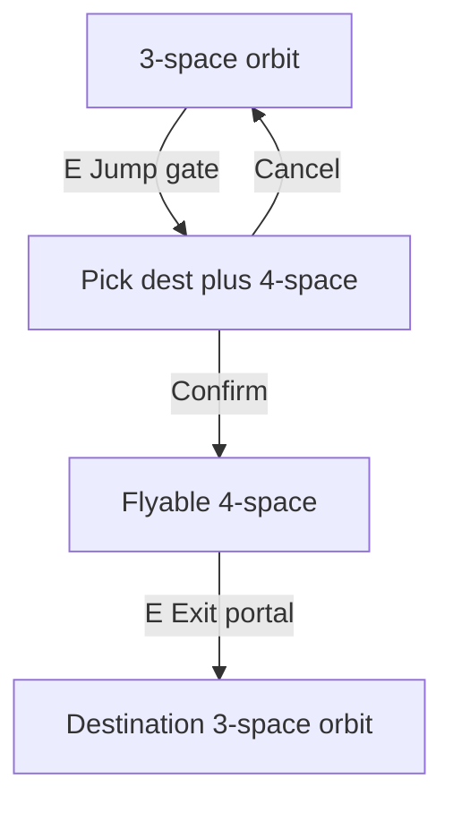

# Architecture

High-level structure of the Godot 4.7 near-orbit game. Historical design notes from the original Java/XML design repo are reference only.

## Design principles

1. **Gameplay logic without nodes** - rules, state, and catalog loading live in `scripts/gameplay/` as `RefCounted` types. No scene tree dependency.
2. **Presentation adapts data** - `scripts/presentation/` wires Godot nodes to gameplay objects (`CharacterBody2D`, world scenes, camera).
3. **UI is thin** - `scripts/ui/` binds `CanvasLayer` overlays to session and catalog; it emits signals rather than mutating game state directly.
4. **Data-driven content** - orbit layouts, interactables, ships, habitats, and jump routes come from JSON under `data/catalog/`.

## Directory layout

| Path | Role |
|------|------|
| `scripts/gameplay/` | `Catalog`, generated catalog records (`AmmunitionDef`, `ChassisDef`, `CommodityDef`, `EconomyDef`, `ModuleDef`, `ShipDef`, `SectorDef`, plus shared `CatalogSignature` / `CatalogDamagePackets` / `CatalogNeighborhood`), `GameSession`, `PlayerState`, `WorldPresence`, `Fleet`, `Wallet`, `CombatPersistence`, `EventBus`, `SimEvent`, `GameVersion`, `SaveStore`, `GalacticCalendar`, `Simulation`, `SimClock`, `SimSubsystem`, `EconomySubsystem`, `MissionSubsystem`, `PlotlineSubsystem`, `CharterBook`, `CharterResolution`, `GameClock`, `CommodityEconomy`, `ShipAssembler`, `ShipAssembly`, `ShipSimCore`, `ShipOperations`, `ShipWeapons`, `ShipCombat`, `ShipCombatState`, `ShipMotion`, `ShipStats`, `OwnedShip`, `AssembledShip`, `ShipOperatingState`, `SensorSystem`, `FieldConditions`, `WeaponHit`, `WeaponHitContext`, `DebrisHealth`, `TransponderBroadcast`, `CombatPilot`, `TrafficDirector`, `TrafficActor`, `TrafficSpawn`, `TrafficDetection`, `TrafficRouting`, `InteractableDef`, `CareerStats`, `CareerWorth`, `MessageSubsystem`, `FuelEconomy`, `Sanctions`, `TranslationNav`, `VolatileTranslation`, `VolatileSites`, `PassengerCharters`, `FreightCharters`, `ScanCharters`, `BountyCharters`, `CargoRequirements`, `Autopilot`, `TargetLock`, `TargetScan`, `FlightManifest`, `CorporatePresence` |
| `scripts/presentation/` | `main.gd`, `FlightLoopController`, `WorldController`, `MenuController`, `player_ship.gd`, `npc_ship.gd`, `EngineExhaust`, `ShipVisual`, `TrafficView`, `PresentationNodePool`, `BallisticHit`, `world_loader.gd`, `world_nav.gd`, `world_object.gd`, `interactable.gd`, camera, starfield; **AudioManager** autoload and `scripts/presentation/audio/` (library, settings, gates) — see [audio.md](audio.md) |
| `scripts/ui/` | HUD, main menu, save overlay, pause overlay, jump overlay, `UiRoot`, `ScreenStack`, habitat/shipyard screens |
| `scenes/ui/` | Full-screen habitat UI, shipyard assembly, reusable components |
| `data/catalog/` | JSON catalogs; machine-readable schema subset under `data/catalog/schema/` (field tables: [catalog_schema.md](catalog_schema.md); narrative: [data_model.md](data_model.md)) |
| `scripts/tools/` | Catalog validators including `validate_sector_completeness.py` and `generate_sector_bundle.py` for multi-file sector authoring; `catalog_sheet.py` for CSV export/import of record tables; `balance_report.gd` prints headless balance tables built by `BalanceMetrics` (`balance_metrics.gd`) through the real assembler, economy, combat, and charter code - see [balance.md](../content/balance.md#process-and-guard-rails) |
| `assets/` | Art referenced by catalog paths; `assets/audio/` for OGG music, ambience, and SFX |
| `data/audio/` | Logical audio library (`library.json`) |
| `themes/` | `cartel_theme.tres` - corporate UI theme (see [ui_theme.md](ui_theme.md)) |

## Data flow

`GameSession` is an aggregate root: `PlayerState`, `WorldPresence`, `Fleet`, `Wallet`, and `CombatPersistence` own the fields. `session.credits` is read-only. Pay and penalties go through `add_credits`, `try_spend_credits`, `assess_penalty_credits`, and `apply_credits_delta`, which publish `credits_changed`. New game and save load write `wallet.credits` and do not publish. Other public properties still forward, including `session.owned_ships`. Save JSON keys are unchanged - `to_dict` / `from_save` compose the slice serializers.

On startup, `main.gd` wires three presentation controllers and delegates to them:

1. Loads `Catalog.load_default()` - ammunition, chassis, modules (from `data/catalog/modules/*.json`), ships, sectors, and economies materialise as generated `*Def` records at load. Gameplay, presentation, and docked UI read those records or the `AssembledShip` chassis accessors. `AssembledShip` stores `ModuleDef` for installed modules and both a `ChassisDef` and a chassis dictionary; assigning the dictionary clears `chassis_def`, so a test stub still wins. Yard part listing and module tooltips still use `Dictionary` (`list_yard_parts`, `get_part_def`, `ModuleDef.to_dict()` for `ModuleSpecText`). The dictionary getters stay for compatibility.
2. **MenuController** shows the **main menu** (New Game / Load / Exit).
3. **New Game** - player enters callsign, portrait, and background; `GameSession.start_new_game` seeds fleet from `backgrounds.json`, docks at the kit's habitat, and opens **HabitatScreen** at the Terminal.
4. **Load** - reads a JSON slot from `user://saves/` and restores session, fleet, cargo, spare parts, and flight state.
5. **WorldController** assembles the current ship via `ShipAssembler.assemble_owned` and calls `WorldLoader.load_sector` or `load_unspace` to populate `$World`.
6. **FlightLoopController** ticks traffic and feeds nav/signature HUD each physics frame when flight is active.
7. Controllers bind HUD and overlays to session state; `main.gd` keeps `session` and `try_interact` on the node, and injects `session` into `PlayerShip` / `FollowCamera` via `configure` / `bind_session`.

## Habitat UI (menu planet)

Docking opens **UiRoot** - a full-screen opaque Control UI (not a dim overlay). Navigation uses **ScreenStack** (`push_screen`, `pop_screen`, `replace_screen`):

- **HabitatScreen** - location shell (future orbitals/malls reuse the same pattern): habitat header (name, description, pilot, credits, GST); two-column body with a narrow **building list** and a right column. Each building shows a **building header** (name + long description left, banner art right) and a non-scrollable **`ContentPane`** below it. **Corporate office** and HQ headers overlay the corporation logo (`assets/ui/corps/logos/<callsign_prefix>.png`) on the banner at native pixel size, right-aligned and vertically centred, clipped to the 160 px banner (left fade unchanged). Building types resolve through **BuildingPanelRegistry** (`embed` / `placeholder`). **TerminalPanel**, **MarketPanel**, **DealerPanel**, **BarPanel**, and embedded **ShipyardScreen** mount full-rect in `ContentPane` (`configure_embedded(true)` on the yard skips its own `session.changed` subscription; habitat forwards instead). List+detail building UIs scroll **vertically only** inside the detail column, never at the location pane. Unknown types still show a placeholder label in `ContentPane`. Building `short_desc` is tooltips only - transactional messages use the habitat **`MessageBar`** strip (`play_line` queues independent scrolling labels).
- **TerminalPanel** - docked ship list, **ShipDetailPanel**, admin column (rename, undock blockers, refuel, rearm, repair, Launch), and separate **Departures** and **Freight** tabs with [`PassengerCharterPanel`](../../../scripts/ui/passenger_charter_panel.gd) and [`FreightCharterPanel`](../../../scripts/ui/freight_charter_panel.gd) (passenger-only and freight-only boards). [`ScanCharterPanel`](../../../scripts/ui/scan_charter_panel.gd), peacekeeping, and the corporate office use the same [`CharterBoard`](../../../scripts/ui/charter_board.gd) chrome: ship line, then one **posted** three-column tile grid and one **accepted** grid. [`CharterChit`](../../../scripts/ui/charter_chit.gd) pairs each row with tile copy and accept or cancel hooks; [`CharterBoard.interleave`](../../../scripts/ui/charter_board.gd) round-robins chit groups so a desk can mix kinds in one grid. Peacekeeping and corporate offices interleave scan and bounty offers and accepted contracts (heading **ACCEPTED** only). **BarPanel** adds a **BAR** gossip ticker, then one mixed board: informal passenger fares plus this bar’s scan and bounty work in the posted grid (no per-type headings). Hover tooltips stay in [`CharterTooltipText`](../../../scripts/ui/charter_tooltip_text.gd) (sectioned copy, suggested public route when multi-hop, bulleted requirements, accept blockers), including `format_scan` and `format_bounty`. **CorporateOfficePanel** wraps the scan desk with a corporation-tagged ticker (`callsign_prefix`) fed by [`CorporateOfficeTape`](../../../scripts/gameplay/corporate_office_tape.gd): equal-weight samples among own-catalogue SKUs (`maker`), the corporation’s non-SKU `brands` list (banks, franchises, services), posted scan/bounty titles at that building, the `trade` line, and shared recruitment copy keyed by `ad_voice` (`polished`, `blunt`, `cheerful`, `severe`, `slick`, `courtly`) in [`corporate_office_ticker.json`](../../../data/catalog/corporate_office_ticker.json). Copy uses the same [`MessageEmitterTokens.apply_template`](../../../scripts/gameplay/message_emitter_tokens.gd) pass as WIRE/headlines (shared sector bindings, `{low-high}` integer ranges, and `{option|option}` choices); the desk overlays `{brand}`, `{product}`, `{title}`, and `{destination}` where relevant. Bar gossip lines are direct overheard speech wrapped in quotation marks at display time.
- **ShipDetailPanel** - shared owned-ship readout (art, optional summary, modules and/or engineering/flight blocks, signature via `ModuleSpecText`). **TerminalPanel** and **ShipyardScreen** configure section flags; the refit slot board lives on **ShipyardRefitScreen** only.
- **UI patterns** - production habitat panels use `scenes/ui/patterns/` (`status_row`, `headline_item`, `metric_block`, `message_bar`) via [`UiPatterns`](../../../scripts/ui/ui_patterns.gd). Yard stock row subtitles use `ModuleSpecText.format_stock_list_meta`. Transactional status uses **`MessageBar.play_line`** when `session.last_log` changes (each line scrolls once; new lines queue with gap). `compact_toolbar`, `data_table`, and `alert_banner` remain showcase references for now.
- **MarketPanel** - exchange listings plus scrollable commodity detail; buy/sell via `GameSession`. A **TAPE** message bar streams noisy off-system commodity prints (not the local board price).
- **DealerPanel** - used-ship or chassis stock from building `stock`; scrollable detail with buy.
- **ShipyardScreen** - embedded yard body matching the terminal **Docking Bay** layout (docked-ship list, **YARD STOCK** module-price ticker via [`YardModuleTape`](../../../scripts/ui/yard_module_tape.gd), **ShipDetailPanel**, refuel/rearm/repair, **Refit** instead of launch). **Refit** pushes **ShipyardRefitScreen** on **ScreenStack** for the full viewport. **ShipyardRefitScreen** - slot board with drag-and-drop fitting, engineering budgets, tabbed yard stock by module category, buy/sell. Propulsion stock sorts by price, type, or thrust; row meta shows `engine_type` and thrust. Power stock sorts by price, type, or MW; row meta shows `plant_type` and output. Computer stock sorts by price, type, or CU; row meta shows `core_type` and capacity. Life support stock sorts by price or crew; row meta shows crew, Transport vs Habitat, and luxury flags. Hover any yard part or occupied slot for full module specs via `ModuleSpecText.format_tooltip()`. Propulsion modules carry `brand` and `engine_type` (`chemical` | `hydro_thermal` | `electric_plasma` | `direct_fusion` | `antimatter` | `gravitic` | `integrated_sail`); power modules carry `brand` and `plant_type` (`fission` | `fusion` | `radioisotope`); computer modules carry `brand` and `core_type` (`silicon` | `photon` | `quantum`); life support modules carry `brand` and optional `ls_habitat` / `ls_comfort` / `ls_luxury` capability flags in `data/catalog/modules/life_support.json`. `ls_habitat` marks live-aboard cabin volume; its absence is transport seating. LSS `volume` includes that cabin.

Reusable DnD components live under `scenes/ui/components/` (`module_slot`, `module_stock_item`).

UI scripts receive a **UiContext** (`catalog`, `session`, `stack`, callbacks). They never load JSON or run gameplay rules directly - they call `GameSession` / `ShipAssembly` and refresh on `session.changed`.

**GameScreen** (`scripts/ui/game_screen.gd`) is the shared base for docked location UI: `bind(context)` stores **UiContext**, connects `session.changed` (deferred) to `session_changed()`, and disconnects in `_exit_tree`. The default `session_changed()` calls `refresh()`; panels override it for soft updates (terminal docking bay, market quotes, dealer detail, yard chrome, charter boards, bar/corporate tapes) while `refresh()` still rebuilds when the building or layout changes. **HabitatScreen** syncs header chrome on `session_changed` and forwards to the embedded panel. Embedded **ShipyardScreen** skips its own `changed` subscription; habitat forwards instead. **ShipyardScreen** is identified with `is ShipyardScreen`; **ShipyardRefitScreen** with `is ShipyardRefitScreen`, not script path. Switching buildings pops a stacked refit screen. CanvasLayer overlays (menu, pause, HUD, jump) stay plain `Control` / `CanvasLayer` nodes.

- **New building panel** - scene root extends **GameScreen**; override `refresh()`; optional `configure(building)` for building-specific state; register the scene in **BuildingPanelRegistry** `_EMBED_SCENES`. Habitat embeds the panel in `ContentPane` and calls `bind(context)` plus `configure` when the building is selected.
- **New stack screen** (rare) - same base; override `handle_back()` only if the default pop is wrong; push via **UiRoot** / habitat and call `bind(context)`.

Location and building art paths live in catalog JSON under `assets/ui/locations/` (placeholder SVGs today).

Dev sandbox launcher scripts and a summary table: [dev_sandboxes.md](dev_sandboxes.md).

### Ship assembly sandbox

For fitting and engineering work without the full game loop, run `./scripts/dev/ship_assembly_sandbox.sh` or `scenes/dev/ship_assembly_sandbox.tscn` (editor **F6**). It bootstraps `Catalog`, a sandbox `GameSession` (`session.sandbox = true`), a docked-ship list, and **ShipyardRefitScreen** with buy/sell disabled and unlimited module drag from catalog. Toolbar actions add empty hulls, strip modules, and restore manufacturer templates. Fitting validation (mounts, mass, volume) matches the main game.

### Combat sandbox

For 1v1 combat iteration without the full game loop, run `./scripts/dev/combat_sandbox.sh` or editor **F6** on `combat_sandbox.tscn`. Combat and stealth sandboxes extend **`FlightSandboxBase`**, which binds **`FlightLoopController`** to the sandbox session. The setup overlay lists all manufacturer templates from `ships.json` with read-only stats and installed systems. **Begin bout** places player and opponent on the starfield just beyond combined weapon range, facing each other with zero velocity. The opponent is a scripted **`TrafficDirector`** roster of one ship; **`FlightLoopController.physics_tick`** runs detection and the actor step. The sandbox keeps a single always-visible **`NpcShip`**. Opponent attitude is **Fight to the death** (default, stays engaged) or **Standard NPC** (provoked fight-or-flight from `TrafficActor`). **Esc** ends the bout and returns to setup. There are no sector landmarks and no habitat UI.

### Stealth sandbox

For signature and detection iteration without Proxima traffic, run `./scripts/dev/stealth_sandbox.sh` or editor **F6** on `stealth_sandbox.tscn`. **Begin drill** spawns the player at the origin with transponders off and 1–12 copies of the chosen target hull scattered near the rim of the player’s **`sensor_range`** (minimap matches that envelope). HUD nav and signature use **`FlightLoopController.present_flight_frame`**. NPC world sprites fade in and out over ~0.4 s when channel threshold detection (`player_detected`) changes; radar blips stay instant. NPCs remain peaceful until sandbox acquire logic sees the player via signature channels or visual range, then they **ENGAGE** or **FLEE** per attitude. **Esc** returns to setup. Does not change production traffic’s combat-only reciprocal sensing cull.

### Mission harness

For volatile translation sites and scan/bounty objectives without the outbound jump or dock-to-pay loop, run `./scripts/dev/mission_harness.sh` or editor **F6** on `mission_harness.tscn`. The setup overlay picks a manufacturer hull, a **source system** (for grant metadata and return-gate destination only), a **scan**, **bounty**, or **site-only** job, and a row from `volatile_sites.json` (or random). **Begin** asks `MissionSubsystem.seed_harness_scan_offer` or `seed_harness_bounty_offer` for one peacekeeping offer. Those methods call `ScanCharters.build_pinned_offer` and `BountyCharters.build_pinned_offer`, then replace today's board so accept uses the production offer fields. Site-only still calls `VolatileTranslation.grant` directly. Begin then marks the outbound hop consumed and starts the production flight loop already **inside** the volatile sector with the temporary return gate present. **F8** or pause **Quit to menu** reloads the harness setup. N is fixed at 4 on the grant; the harness does not fly the translation.

### System render tester

For planetary layout and globe texture inspection without player, ships, or traffic, run `./scripts/dev/system_render_tester.sh` or editor **F6** on `system_render_tester.tscn`. A toolbar lists catalog sectors that define a `planet` in `worlds.json` (`planet_name - star_system`). **WorldLoader.load_sector** builds the same near-orbit visuals as flight (planet backdrop, orbital ring, jump gate, local star, dust ring). A free **Camera2D** supports pan (LMB drag), zoom (wheel), and **F** / **Frame** to fit the system. **RMB drag** yaws/pitches the globe via `PlanetBackdrop.add_inspection_rotation`; **Planet auto-spin** toggles catalog rotation. Each load starts from a random yaw. City-Mall anchors from a night habitations sidecar use the same screen labels as the flight HUD, and they track auto-spin and inspection drag. Orbital ring motion uses `session.advance_orbital_phase` only - no traffic director or simulation subsystems.

### Parent body harness

For tuning **`parent_body`** appearance and rings before editing catalog JSON, run `./scripts/dev/parent_body_harness.sh` or **F6** on `parent_body_harness.tscn`. The left panel loads presets from worlds that already define a parent, exposes appearance type (`banded`), band colours, turbulence, polar inclination and band meridian (manual or seed-derived; rings follow the equator), ring type/scale, angular diameter, backdrop distance, star/parent angles, and seed key. **SkyParentBody** and **LocalStar** use the same shaders as flight. Live edits rebuild the preview; **Copy JSON** puts the `appearance` and `rings` objects on the clipboard. Pan (LMB), zoom (wheel), **F** / **Frame** to fit the parent and star.

## Main scene structure

`scenes/main.tscn`:

- **Starfield** - seamless tiled parallax background (`starfield.gd`, `starfield_tiling.gd`); recentres a window of 512 px tiles around the camera each frame so sector flight has no sky edge. `play_bounds` remains the dust-ring landmark only.
- **World** - empty at edit time; populated at runtime by `WorldLoader`.
- **PlayerShip** - inertial flight, interaction sensor, camera.
- **HUD** - capability-gated flight chrome: top-left **SHIP** (`basic_hud`: power, fuel, compute, life support, hull), centred top strip (callsign aboard ship name, speed, heading, GST clock; click or **I** opens the in-flight ship manifest - modules, trade cargo, passenger charters, and freight - without pausing), top-right **Fields** (`local_sensor`), right-edge chits under Fields (target-lock summary with hull sprite or world sprite, range, and transponder lines for ships or kind label for landmarks when `basic_target_lock`; autopilot chit with mode when not manual), bottom-left **signature** (thermal / gravitational / EM / computational totals, transponder, active sensors), bottom-centre transactional message bar (`last_log`) above a **WIRE** headline ticker at the rim (planetary sectors only); both use the `HudTicker` panel style (slightly translucent), bottom-right local radar (click opens a centred square **area map** at extended scale without pausing: 500 m world grid, colour-coded visual and per-fitted-sensor range circles for the piloted ship only, lock marker, click-to-lock when `basic_target_lock`; Escape or click outside closes; legend covers the minimap) and viewport-edge waypoint arrows (`local_sensor` / waypoints), transponder label overlay (`sensor_read_beacons`), target-lock corner brackets on the locked contact (`basic_target_lock`, `` ` `` toggle / Tab cycle among all local contacts including habitats, orbitals, gates, planets, stars, debris, and unspace inhabitants). **Y** or a click on the target chit opens a non-pausing **Target scan** panel (`TargetScan` gameplay snapshot) and appends a `{contact_id, contact_kind, sector_id, recorded_gst}` record on `PlayerState.scanned_contacts` for future missions. Hidden when docked.
- **MainMenu** - New Game, Load, Exit; untitled bottom **HudTicker** opens with a [`GameVersion`](../../../scripts/gameplay/game_version.gd) line (`Cartel 2, version '…'`), then alternates a random **`headlines`** sample (same emitters as the flight WIRE bar, each bound to a random planetary hub) with hall-of-fame lines for profit ranks 1–3 at fixed fill indices after the version line (`MenuHeadlineTape.next_menu_line`), then continues with headlines only.
- **NewGameOverlay** - callsign, portrait picker, and background kit form.
- **SaveOverlay** - three-slot save/load browser.
- **PauseOverlay** - Resume, Save, Load, Quit to Menu (Escape during flight).
- **UiRoot** - opaque full-screen habitat UI with ScreenStack.
- **JumpOverlay** - Unspace route list at jump gates and translation beacons.
- **HyperdriveOverlay** - Same route database as **JumpOverlay** (non-pausing) plus **Compute solution** tab for any catalog destination; 15s–3min GST in-sector calculation with HUD progress tile (**H** outside the gravity well).

## Player loops

### Orbital flight

- `ShipSimCore` orchestrates the shared flight rules (shields, ops, signature glow, mass/stats, weapons, motion). The player calls every step each physics frame for HUD telemetry; slotted NPC traffic uses the same steps with interval stats refresh; unslotted NPCs skip ops/weapons/stats and only run cheap motion + glow. After weapons tick, `GameSession.apply_player_flight_step` records operating warnings, career shots, and ammo-driven `changed` emits; `player_ship.gd` only spawns projectiles and reads input via injected interact and world hooks from `main.gd`.
- `ShipMotion` integrates thrust, rotation, boost, and damping from `ShipStats` (derived from assembled modules and loaded mass), modulated by operating-state `thrust_factor` and optional **environment scale** (`FieldConditions.thrust_scale_for_ship`: gravitic × local gravity, integrated sail × radiant/particle/magnetic mix, otherwise 1.0).
- `FieldConditions.sample(catalog, world, position)` reads sector `neighborhood` and world layout radii in 3-space, or a fixed unspace profile when `WorldPresence.in_unspace`. Rules: [field_conditions.md](../content/field_conditions.md).
- Hold **Space** (`fire`) to discharge the **selected** weapon along ship facing. Keys **1–9** and HUD chits pick the active mount; NPCs rotate one weapon per new fire press with a short stagger before the first shot. `ShipWeapons` handles per-slot cooldowns and ammo; `ShipOperations` allocates power for the active weapon only while firing.
- **Autopilot** (`autopilot_basic` on navigation computers except Section): **F1–F9** modes via [`Autopilot`](../../../scripts/gameplay/autopilot.gd) on the player ship. Uses world-space Newtonian motion, the current target lock for align/pursuit/velocity modes, and the right-edge autopilot chit. Temporary modes (align with velocity, reverse align, full stop) return to manual when complete; stick input cancels most automated modes.
- `play_bounds` per sector defines the distant dust ring (visual landmark only; player flight is unbounded).
- `Interactable` areas on world objects; player `InteractSensor` picks nearest valid target.
- Flight HUD elements require installed module capabilities (`basic_hud`, `local_sensor`, `local_system_waypoints`, `sensor_read_beacons`, `basic_target_lock`, `4_space_topology` for unspace exit labelling). In-system ships require a powered `vessel_registration_beacon` (Commercial Article 19).

### Interaction kinds

| Kind | Behaviour |
|------|-----------|
| `inspect` | Log flavour text; track `inspected_ids` |
| `salvage` | One-time credits; id tracked in `salvaged_ids`; host `WorldObject` visual modulated (not a dedicated wreck scene) |
| `dock` | Pause tree, hide HUD, open UiRoot habitat screen, park current ship at habitat |
| `translate` | Pause tree, open jump overlay with nav-computer translations (solution, N, accuracy, duration) |
| `arrive` | At 4-space exit portal: complete transit into destination 3-space orbit |

Dock and jump-route selection set `get_tree().paused = true` until the overlay closes. **4-space transit itself is unpaused** - same inertial flight with hazards.

### Docking and shipyard

1. `[E]` at habitat → `session.dock(catalog, habitat_id)` → **HabitatScreen**.
2. Visit buildings from catalog list; **Proxima Exchange** for commodity buy/sell (per-ship cargo holds); **Shipyard** lists docked ships with refuel, rearm, and repair in the habitat content pane.
3. **Refit** opens **ShipyardRefitScreen** full-screen on **ScreenStack**. Chassis is **fixed** per ship; modules install from **spare_parts** inventory by dragging stock onto compatible slots (or click spare then click slot). Buy at yard fills spares; drag off a slot to uninstall. Engineering readout shows mass, volume, power, compute, and fuel budgets while fitting.
4. Undock: **Terminal** → select docked ship → **Undock** → resume flight.

Ships parked at a habitat **stay there when jumping sectors** (only the aboard ship travels).

### Galactic Standard Time (GST)

Session state stores `gst_seconds` (calendar: [setting/date_time.md](../../setting/date_time.md); how the clock advances: [gst.md](../content/gst.md)). `GalacticCalendar` formats timestamps. `Simulation.step` in `main.gd` advances time each frame (GST freeze from **MenuController** when paused, in menus, or docked in habitat UI) and dispatches registered subsystems (economy reposts market quotes on day rollover). Daily commodity pricing is specified in [commodity_economy.md](commodity_economy.md). `GameClock` remains a thin facade over `Simulation` for tests and legacy callers.

Successful gameplay mutations publish typed events on `GameSession.events` (`EventBus` + `SimEvent` factories - e.g. `commodity_traded`, `sector_entered`, `docked`). `Simulation.attach_events` subscribes to that bus and calls `dispatch_event`, which calls `SimSubsystem.on_event(session, catalog, evt)`. **MenuController** attaches and detaches when it replaces the session object. UI still refreshes on the coarse `session.changed` signal; typed events are for simulation subsystems and future mission/faction hooks, not HUD wiring.

`MissionSubsystem` is registered on production `Simulation` and drives daily passenger
charter offers from `passenger_missions.json` (terminal departures and civilian fares at
bars), freight lots from `freight_missions.json`, and **scan charters** from
`scan_missions.json`. Scan work is **combinatorial**: [`ScanCharters`](../../../scripts/gameplay/scan_charters.gd)
assembles each offer from a mechanical **type** (reconnaissance, intelligence, survey,
inspection, assessment), a desk **source** (peacekeeping, corporate office, bar), an optional
**client** corporation (`practice` + `ad_voice` on [`corporations.json`](../../../data/catalog/corporations.json)),
a **target** kind, and a **location**. Global timing and pay knobs stay at the top of
`scan_missions.json`; types declare objective, eligible sources, targets, and difficulty.
Player-facing titles use practice-specific work phrases (for example finance “asset verification”
vs aerospace “hull condition check” for the same inspection type); descriptions come from
peacekeeping frame lists or voice-keyed corporate/bar templates with `{client}`, `{work}`, and
`{site}`. Volatile locations pick a row from [`volatile_sites.json`](../../../data/catalog/volatile_sites.json)
(label, optional star, and count ranges for debris, orbitals, derelicts, cargo, nav or survey
markers, proximity mines, and anonymous loitering ships). Grant rolls those counts into placed
props and `setup.ambient_ships`, then merges the mission contact. Accept grants a volatile survey site or a neighbouring planet; the pilot
**active-scans** the contracted contact (`PlayerState.scan_satisfies_contract` matches
sector and post-accept timestamp), then docks back at the **origin** habitat for pay.
Volatile grants carry optional `setup.scan_contact` ship contacts spawned in
`WorldLoader._load_volatile_sector`. Daily boards invalidate at GST day rollover; the first
charter UI open at a docked habitat generates that habitat’s passenger, freight, and scan
offers only (not every habitat in the catalog). Accepted charters persist in subsystem
save data (missions save version 5); completion and cancellation are handled in gameplay,
not UI. On-time pay, a late fee, and a missed deadline settle through `CharterResolution`.
Each kind keeps its offer map, accepted list, and id counter on a `CharterBook`. Passenger and freight accept share that book path. Scan and bounty still grant the volatile site inside `accept_scan_offer` and `accept_bounty_offer`. Save keys and id prefixes are unchanged.
A scan contract is complete when `ScanCharters.charter_satisfied` matches the active scan.

**Bounty charters** from `bounty_missions.json` post on the same peacekeeping, corporate,
and bar desks as scan work (peaceforce always one per day; corporate and bar roll at lower
chance). Each habitat building of type `bar` posts its own board. `BarPanel` configures that desk from the building it was opened with. Each offer is **combinatorial**: [`BountyCharters`](../../../scripts/gameplay/bounty_charters.gd)
draws an **objective** (destroy, intercept, disable, eliminate), wanted **reason** and **status**
lines, a **threat** (pay multiplier plus a profile), any catalog **armed ship** template, a volatile **site** from
[`volatile_sites.json`](../../../data/catalog/volatile_sites.json), and a desk **frame** with substituted
`{objective}`, `{callsign}`, `{ship}`, `{site}`, `{reason}`, `{status}`, `{threat}`, and `{corp}`.
Board titles use the objective name; site headings keep the catalogue label. A threat profile sets
pay scaling via hull scale and escort count; its optional `pilot_skill` only biases hidden behaviour rolls.
Accepting grants a volatile site with randomised `setup.entry_position` (temporary return gate) and
`setup.bounty_target` position (at least 2000 m from the gate), plus optional `setup.bounty_escorts`.
[`BountyBehavior`](../../../scripts/gameplay/bounty_behavior.gd) rolls hidden per-ship posture
(`stealthy`, `aggressive`, `oblivious`), resolve (`fight` / `flee`), transponder on/off, station
(`hold` / `wander`), pilot skill, and flee route (`beacon`, `hyperdrive`, `deep_space`) into the ship
records; board copy does not reveal them. Escort groups use matched, bodyguard, ambush, or decoy mixes.
`FlightLoopController` spawns bounty ships with [`TrafficSpawn.create_from_bounty_target`](../../../scripts/gameplay/traffic_spawn.gd);
fight resolves to fight-to-death, flee breaks toward deep space, the entry beacon, or a hyperdrive
rim run. Named targets that escape may enter [`bounty_pursuit`](../../../scripts/gameplay/bounty_behavior.gd)
(Unspace then origin dock timers); kills during pursuit credit against the contract volatile sector.
Only the named target completes the contract. Destroy, intercept, and eliminate contracts record
`bounty_target` when the hull is destroyed; **disable** records `bounty_disabled` when effective
power generation reaches zero and still pays if the target is destroyed instead. Completion is
`BountyCharters.charter_satisfied`, which uses `PlayerState.scan_satisfies_contract_kinds`
(sector and post-accept timestamp); pay lands when the
pilot docks back at the origin habitat before the return gate expires. Sanctions do not apply in
volatile sectors. Missions save version 5 adds bounty offer and accepted lists.

[`PlotlineSubsystem`](../../../scripts/gameplay/plotline_subsystem.gd) (`plotlines`, save version 1) runs optional background arcs from [`plotlines.json`](../../../data/catalog/plotlines.json). Each arc is a small state machine: GST day rollover and typed session events advance states; `accept_gig` / `complete_gig` are the write path for future desk UI. While in a state, the subsystem can contribute weighted ticker lines and derived gig records. [`MissionSubsystem.list_plot_gigs`](../../../scripts/gameplay/mission_subsystem.gd) exposes gigs; no board UI yet. Full rules: [plotlines.md](../content/plotlines.md).

[`MessageSubsystem`](../../../scripts/gameplay/message_subsystem.gd) samples weighted **emitters** from [`message_emitters.json`](../../../data/catalog/message_emitters.json) on demand for two channels: **`headlines`** (flight HUD **WIRE** tape in planetary sectors, and the main-menu bottom ticker via a private subsystem plus scratch [`GameSession`](../../../scripts/gameplay/game_session.gd)) and **`gossip`** (bar **BAR** tape). Planetary hubs for menu sampling are listed by [`MessageEmitterTokens.list_planetary_hub_sector_ids`](../../../scripts/gameplay/message_emitter_tokens.gd) (worlds with a jump gate, same rule as the exchange tape). [`MessageEmitterTokens.build_sector_bindings`](../../../scripts/gameplay/message_emitter_tokens.gd) fills sector-scoped names (`{corporation}`, `{rival}`, `{corporation-ticker}`, `{rival-ticker}`, `{brand}`, `{rival-brand}`, `{habitat}`, `{planet}`, `{planet2}` (main world of another `star_system`), `{city-mall}`, `{city-mall2}`, `{celebrity-pilot}` (alias `{celebrity}`), `{local-star-system-location}`, `{jump-destination}`, `{sport}`, `{shift}`) and, when a quote exists, `{commodity}`, `{price}`, and `{move}`. Templates may also use inline `{low-high}` integers and `{option|option}` choices resolved in `apply_template`. The commodities emitter requires a live quote. The gossip-only `charters` emitter overlays `{destination}`, `{quantity}`, `{label}`, and `{desk}` from posted bar and terminal offers via `Simulation` → `MissionSubsystem`. When sampling with a production `Simulation`, active plotline states merge additional weighted templates (plotline instance flags fill `{token}` bindings). `push(channel, text)` queues plot- or player-driven lines for a later phase; UI uses the same scrolling **`MessageBar.play_line`** tape pattern as market price data.

| Context | GST behaviour |
|---------|---------------|
| Realspace flight | 1:1 with real time |
| Habitat / building UI | 1:1 (tree may be paused; clock uses `PROCESS_MODE_ALWAYS`) |
| Unspace flight | Irregular pulses - stutter and jumps, more erratic at higher N |
| Jump gate entry / exit portal | Discrete lump from the selected translation (`entry_seconds`, `exit_seconds`, `time_jitter`) |
| Main menu, pause, save/load, jump picker | Frozen |

HUD and **HabitatScreen** header show `GstClockLabel` at seconds resolution. `session.changed` is **not** emitted every second - widgets poll `gst_seconds` directly.

### Jump travel (3-space ↔ 4-space ↔ 3-space)

1. `[E]` at jump gate (3-space only) → jump overlay lists offered translations from `TranslationNav` (nav computer inventory plus player library).
2. Select a line (`solution`, destination, N, accuracy, expected duration) → confirm.
3. Confirm → roll **translation stability** → `session.enter_unspace` (by solution) → entry lump from that translation → `WorldLoader.load_unspace` (presentation world `n{n}_default` for translation N) → player at entry spawn.
4. Fly through transit field: irregular Delaunay topo mesh; **Fields** panel shows **Stability** for this jump. GST advances irregularly while in transit.
5. `[E]` at **Exit Portal** → exit lump from the same stored translation → `session.arrive_from_unspace` (clears stability) → load destination sector orbit.

Hyperdrive-equipped ships may later translate without a gate or from other 4-space regions - not implemented.

### Volatile translations (off-network sites)

Scan charters (other than a planet target) and bounty charters grant a **volatile translation**: a one-shot, expiring navigation solution stored on the player (`PlayerState.volatile_translations`), not in catalog `routes.json`. Each record names a source catalog sector, destination label, **N-space layer** (4, 5, or 6), GST deadlines for the outbound offer and the temporary return gate, and optional **site setup** (play bounds, star tuning, debris/orbital entities). The destination sector id is synthetic (`volatile:<record_id>`); the site is rebuilt from the record whenever the player is there or reloads a save. Posted scan and bounty tiles and their hover text show the granted layer (`4-space` … `6-space`) so the pilot can judge Unspace risk; pay multiplies by **1.0 / 1.5 / 2.0** for N 4 / 5 / 6 (`VolatileTranslation.charter_pay_multiplier`). Planet surveys are in-system and omit the layer.

At the source jump gate, `TranslationNav` unions usable volatile outbound rows into the jump overlay (they do not consume nav-computer capacity; higher N than the computer’s usual tier still rolls with the existing accuracy penalties). Confirming consumes the outbound hop and runs the normal Unspace pipeline (presentation row for the granted N). On arrival, `WorldLoader` spawns a minimal field (dust ring, optional backdrop star chosen at grant time from the local system, the background-star catalogue, or deep space with no star, plus optional entities) and a **temporary return gate** while `return_expires_gst` has not passed. The overlay on-site offers only the return hop to the origin sector at the same N. When the player docks back at the origin, the record is removed; if the return gate expires while they remain on-site, the gate vanishes and they are stranded unless they carry a hyperdrive that can still spool. `VolatileTranslation.sweep` runs after GST advances in `Simulation` to drop expired, unanchored grants.

## World loading

All 26 sectors in `sectors.json` use a structured layout in `worlds.json`, the eleven E-class worlds and the fifteen outlying sectors included:

- **`planet`** - lit 3D globe rendered in an isolated `SubViewport` (1024 px, ~10 Hz `UPDATE_ONCE` while in flight; immediate refresh on sun or inspection rotation) and composited as a 2D disc at the origin (`PlanetBackdrop`, diameter 2000, `z_index -50`). Each sector references `albedo` and `night_lights` equirectangular PNGs (2048×1024 placeholders) under `assets/world/planets/<sector_id>_*.png`; drop-in replacements keep the same paths. `modulate` tints the procedural fallback only, not mapped textures. Legacy `sprite` is ignored for the globe mesh. Day/night terminator follows the sector **`star`** (visit-random position 7000–12000, procedural `LocalStar` at `z_index -40`). Farther stars drop the sun toward the play plane so the disc reads as side-lit; the globe shader uses a narrowed day cone and darker night cap than wrap lighting (luminosity scales brightness only). When `<sector_id>_night_habitations.json` sits beside the night map, the flight HUD and the system render tester draw a City-Mall label, centred on the anchor, for each city that faces the camera, day side and night side. Each sector load picks a random initial yaw; auto-spin continues from that angle, and the angle is not saved.
- **`star`** - presentation-only block on each 3-space world: `temperature_k`, `luminosity`, optional `disc_radius`. Drives apparent disc size, corona colour, and planet `sun_direction` / intensity (not saved between visits).
- **`parent_body`** (optional) - distant parent disc for moon sectors: `name`, body `type` (scan label, e.g. `gas_giant`), `angular_diameter_deg_min` / `angular_diameter_deg_max` (2–20, rolled each visit), and inline `appearance` / `rings` objects (`type` plus renderer parameters). Procedural `SkyParentBody` at `z_index -60`; does not affect planet lighting.
- **`companion_stars`** (optional) - extra `LocalStar` instances on the same visit-random annulus as the primary. Catalogued entries use `star` (name in `stars.json`) and `separation_deg` from the primary’s angle; presentation-only entries (The Widow at Regulus) use `name`, `temperature_k`, `luminosity`, `disc_radius`, and `separation_deg`.
- **`orbital_ring`** - evenly spaced orbitals on a rotating ring (`OrbitalRing`); the civic habitat orbital is the largest and dockable; ring slots with an `interactable` in catalog are dockable lite stations (`habitats.json` `type: station`); unnamed orbitals stay visual-only
- **`jump_gate`** - static gate farther out (angle derived from sector id)
- **`entities`** (optional) - free-floating world objects spawned after the ring and gate (e.g. shootable **debris** rocks); not used for unspace worlds

4-space layouts are defined in `unspaces.json` as a **`field`** block: a one-shot Poisson-scattered point field, Delaunay triangulation (with optional convex quad merges), independent random vertex heights, and a fixed exit portal on a chosen host face. Flat `entities` lists in `worlds.json` are not used for unspace loading.

`WorldLoader.load_unspace` spawns an `NspaceField` instead of sector entity scenes. No dust ring in unspace. The field builds the mesh once from catalog tuning (`fov_vertex_count`, `scatter_margin`, `quad_merge_chance`, `height_scale`) so the play zone plus an FOV margin stays off-screen. **3D presentation** is rendered in an isolated `SubViewport` (`own_world_3d`) and composited behind the ship via `_draw()` on the field node. Heights map to the view axis (`Z`) as a ground plane under the 2D ship; an orthographic `Camera3D` tracks the active `Camera2D`. The exit portal is placed once on a host face from the route seed; its visual is a 3D disc in the backdrop while a hidden 2D `Area2D` handles `[E]` interaction. The unspace **visual** topo field applies no geometric forces on the player; ship flight uses the same `ShipMotion` path as 3-space orbit. **Environmental** field conditions still apply (very low fluctuating gravity, low radiant, fluctuating magnetic and particle indices) and scale gravitic thrust. **Ascidians** (1–3 per visit, visit-randomised spawn) wander in 2D logic but draw in 3D at mid height between min and max vertex Z; opaque terrain depth-tests against them so peaks occlude naturally. They appear as faint unlabeled radar contacts. Higher-N spaces may later project 3D geometry into the play plane; 4-space does not.

`WorldLoader` maps 3-space entity `kind` to packed scenes:

| Kind | Scene |
|------|-------|
| `habitat` | `scenes/world/habitat.tscn` |
| `jump_gate` | `scenes/world/jump_gate.tscn` |
| `orbital` | `scenes/world/orbital.tscn` (visual-only station) |
| `debris` | `scenes/world/debris_rock.tscn` (collision; weapon damage via `DebrisHealth`) |

Habitat and jump gate have interactable areas but **no solid collision** - the player flies over them. Orbital ring phase is persisted in `GameSession.orbital_phase_by_sector` (saved/loaded). `Simulation.step` advances phase for the current sector when in realspace flight; `OrbitalRing` reads phase for rotation (does not write session while docked or in unspace).

Each configured world object uses `WorldObject.configure(entity, catalog, session)` for position, label, sprite override, and interactable binding. 4-space uses `NspaceField.configure(unspace, catalog, session, play_bounds)`.

`WorldLoader.load_unspace` reads the `field` block from schema-validated `unspaces.json` (`UnspaceDef` at load; palette, scatter/Delaunay topo, portal placement, inhabitants). Mesh and portal policy knobs live in catalog data, not hard-coded depth formulas. `GameSession.unspace_solution` is set in `enter_unspace` from the selected route mapping and persisted across saves. Unspace GST irregularity is tuned per entry’s `gst` block (`SimClock` does not multiply by route `n`). Local radar in unspace scales to `play_bounds`. Exit portal nav contacts require the **`4_space_topology`** sensor capability.

The dust ring is a `Line2D` octagon generated from `play_bounds` at 3-space sector load time (not used in unspace). Local radar in 3-space scales to **content radius** (`max(jump_gate_radius, orbital_ring_radius) × 1.15`) so contacts stay readable when the dust ring is much larger than the playable landmarks.

## In-system NPC traffic (3-space)

`TrafficDirector` (gameplay) owns spawn policy, fleet size, sim slots, detection stagger, and actor AI when a sector loads. Each `TrafficActor` is a façade over `TrafficSpawn` (factory), `TrafficDetection` (stagger/contacts), and `TrafficRouting` (peaceful waypoints); tick, combat FSM, and `CombatPilot` wiring stay on the actor. `_sim_slot_pool` on the director is a **priority candidate list** for sim-slot assignment, not a node object pool. `TrafficView` (presentation) owns the `Traffic` node tree - pooled near `npc_ship.tscn` instances for slotted actors and pooled far sprite roots for the rest (release on near↔far LOD crossing instead of always `queue_free` + instantiate). Cached PackedScene for `npc_ship.tscn`. **FlightLoopController** ticks the director then syncs the view each physics frame. When `player_detected` changes, traffic hull sprites fade over ~0.4 s via root `modulate.a` (sector load snaps opacity). Presentation LOD follows `actor.near_lod` (= `has_sim_slot`); catalog `near_lod_radius` is unused in code. Sector landmark nav contacts come from a shared in-place cache on `WorldNav`, which `WorldLoader` owns. Spawn stays on `WorldLoader`; callers still use `get_nav_contacts`, `get_traffic_anchors`, and `is_traffic_route_arrived` on the loader (compose a new array before appending traffic). Not active in Unspace or while docked.

- **Density** - log-scaled from `population_billions` on the sector (`traffic.json` caps; Proxima ~100 ships at population max, smaller worlds less).
- **Spawn** - on sector arrival, trip roles appear 15–85% along their corridor toward destination; loiter/runabout scatter near the jump gate and orbitals. Cycle replacements still launch from origin waypoints.
- **Variation** - per-ship cruise jitter; trip routes steer directly to destination with optional lateral offset at arrival spawn.
- **Simulation LOD** - up to `sim_slot_max` (~20) nearest ships run full `ShipSimCore` steps (`ShipOperations`, weapons, interval stats) and `NpcShip` physics. The rest of the fleet (~100 cap) are kinematic sprites with cheap cruise AI and motion-only sim.
- **Presentation LOD** - follows sim slots: slotted ships use `NpcShip` (`CharacterBody2D`); unslotted ships are distant sprites (not distance-based).
- **Roles** - transit, shuttle, dock_cycle share one-shot waypoint trips; loiter circles near the jump gate; runabout wanders between named anchors (habitat, gate, orbitals) and random free points inside the traffic envelope, repicking on arrival and optionally despawning at anchor stops (50% coin flip).
- **Lifecycle** - trip roles despawn on arrival at habitat, gate, or orbital interactable radius; runabouts may despawn at anchor stops or pick a new waypoint; director immediately spawns a fresh ship at a newly chosen origin (not the previous destination). FLEE ends after a timeout or when the player is far away (returns to TRAFFIC), or cycles out on reaching the flee anchor (habitat/gate); fleeing ships use peaceful velocity blending so they turn tightly instead of settling into orbit. When combat reduces an NPC hull to zero, **`TrafficView`** spawns the same **`ShipBreakup`** shard effect as the player on the world root, then returns the near or far hull to its pool (combat/stealth sandboxes free the opponent node after the same effect).
- **Combat** - provoked only; NPCs engage or flee at full engine cruise. ENGAGE sim-slotted NPCs use an instance `CombatPilot` (`scripts/gameplay/combat_pilot.gd`) fed a kinematic snapshot (position, velocity, facing, thrusting, weapon profile, max speed). Three range bands: **approach** (`> 2× weapon range`) closes at full speed when the target recedes or half speed when both close; **setup** (`weapon range` to `2× range`) flies a ±45° pass at ~55% speed; **dogfight** (`≤ weapon range`) energy-turns on intercept aim, coasts while lining up a shot, and fires whenever a feasible shot exists. When range opens toward `R`, a **maneuver interrupt** pauses fire and burns to cancel sideways relative velocity before closing; orbiting at constant range is treated the same way with **orbit latch hysteresis** so brief radial taps do not drop MANEUVER. Combat steering holds full `rotation_speed` until heading error is tiny. Per-bout standoff and closing-style jitter on `reset()`. **Pilot skill** (`NOVICE` / `EXPERIENCED` / `ELITE`, rolled on `reset()`) sets velocity EMA smoothing, fire graze radius, orbit-exit thresholds, and whether a thrusting target's **facing feint** is believed for intercept/receding/orbit (sticky for the burn). Intercept uses smoothed `target_vel` from `motion.velocity`, not `CharacterBody2D.velocity`. Ballistic, plasma, and rocket rounds inherit shooter velocity at spawn; intercept aim matches that model. Player/NPC hull collision is the **convex hull of chassis SVG primitives** via `HullHitbox` (not texture bounds); scene capsules remain fallback until configure/bind. Fire is independent of band; bore-sight on the aim point unless `CombatPilot.GUIDED_OFFBORE_FIRE` is enabled (future homing). `ShipCombat` resolves typed damage packets (PD → shields → armour → Hits/Power/Compute). Player and NPC shots apply combat damage. Presentation snapshots a `WeaponHitContext` at spawn (session, catalog, shooter id, and whether the shot is the player's) and `WeaponHit` uses that context for career kills and sanctions. Mass-driver rounds and rockets share `BallisticHit` for the ray sweep and for `WeaponHit.apply`. The sweep assigns its exclude list onto the ray, so the shooter is omitted. A proximity mine uses that same apply path with no shooter and no shot velocity, so it deals its packets and does not impart impulse. Lasers stay on their own beam. Point-defence pellets stay cosmetic. At 0 Hits thrust and weapons cut off. Docking repairs hull and integrity.
- **Sensors** - Branded sensor SKUs carry product-level `sensor_range`, `sensor_sensitivity`, optional `sensor_sensitivity_passive`, and `has_active` (no `detectors[]` in JSON). Every sensor SKU also grants **`basic_target_lock`**: one track on any local nav contact (`TargetLock` in gameplay; lock id not persisted). Ship contacts remain detection-gated; landmarks, orbitals, debris, and similar objects are always lockable when present in the sector contact list. `SensorSystem` caches max range and per-channel sensitivity (active vs quiet profiles) at assemble time; in flight the player toggles **Active sensors** (`R`, `OwnedShip.active_sensors_enabled`) to choose full vs quiet sensitivity and whether active packages add ping **`signature{}`**. **Live signature** gates other contributions by operating state (thrust, fire, transponder, power load, compute use) with short propulsion/weapon afterglow. Detection and the flight HUD read live values; shipyard shows fitted totals. **`sensor_range`** is the hard envelope; inside it, contacts appear via **visual** (`visual_contact_radius`, 250 m default), **transponder override** (broadcasting + `local_sensor`), or **channel threshold** (`signature × sensitivity × range_weight ≥ threshold`, easier close / harder at rim). Undetected NPCs are hidden (no sprite, no radar blip). Landmarks/orbitals stay on the nav-contact path. Beacon text overlay only for detected, broadcasting ships with `sensor_read_beacons`. NPC traffic treats active sensors as on. NPC combat steering uses live player position only when the NPC has a reciprocal contact; engaging NPCs with `basic_target_lock` set `locked_target_id` to the player while that contact holds (precursor to guided weapons). Map rim aligns with content radius, not the dust ring.
- **Cruise** - peaceful traffic capped at `cruise_speed_fraction` (default 33%) of each hull's assembled `max_speed`; engage/flee uses full engine rating.
- **Bounds** - NPC recycle envelope is `gate_radius × 1.25`; player flight has no position clamp.

Catalog: `data/catalog/traffic.json`. Presentation: `TrafficView`, `scenes/npc_ship.tscn`, `scripts/presentation/npc_ship.gd`. Near-ship hull setup, damage tint, muzzle offset, and weapon-order spawning for player and slotted NPCs go through **`ShipVisual`** (`ChassisSprite` / `HullHitbox` underneath); **`EngineExhaust`** draws procedural thrust by fitted `engine_type` on the player, near NPCs, and far traffic (hidden `ThrustFlame` keeps stern alignment). Far-LOD traffic sprites stay in `TrafficView`.

## Graphics convention

| Format | Use |
|--------|-----|
| **SVG** | Ships, stations, gates, debris, orbitals |
| **PNG** | Starfield tiles, planet disc, painterly backgrounds |

Chassis entries reference hull **sprites**; SVG paint is the source of colour (hull sprites render at `Color.WHITE`). The optional `hull_color` field is identity metadata (e.g. future radar/livery), not a sprite tint. World entities may override `sprite` and `modulate` in JSON. Workshop chassis swaps update both stats and hull appearance immediately.

**Production dimensions:** [sprite_sizes.md](sprite_sizes.md) - author-at canvas sizes so 1 SVG pixel = 1 world unit (no import-scale compensation).

Create missing placeholders only: `python3 scripts/tools/generate_placeholder_art.py` (skips any file that already exists, then runs Godot import for new SVG/PNG sidecars). If import is skipped, run `godot --path . --import --headless --quit` manually.

UI styling uses the shared **Cartel corporate theme** - see [ui_theme.md](ui_theme.md). Reference viewport: **1920×1080**.

## Save / load

- Three fixed slots: `user://saves/slot_1.json` … `slot_3.json` (directory configurable via `SaveStore.save_dir` for tests).
- Saves store pilot identity, full `GameSession` state (including `spare_parts` and `market_pressure`), owned ship instances (modules, per-ship cargo, fuel, ammunition), player flight position/velocity/facing, and `game_version` (from `GameVersion.VERSION`).
- **Alpha catalog ids:** fitted module and ammunition ids are stored verbatim. Renaming or removing a catalog SKU invalidates existing save slots; there is no save migrator yet.
- Optional top-level `subsystems` envelope: `Simulation.collect_save()` writes one versioned section per registered `SimSubsystem` (`{version, data}` keyed by subsystem `id`). `Simulation.apply_save()` restores each section (running `migrate` when the stored version is older). Missing envelope on v1/v2 saves is valid - subsystems reset to defaults. Session/UI fields are unchanged. The commodity board is derived on load from the GST day, then overlaid with saved `market_pressure` (net units traded per sector and commodity, decayed by half for each GST day since `market_pressure_day`). A save with no pressure fields has an empty overlay.
- Catalog JSON under `data/catalog/` remains read-only; saves never write there.
- Save/load available from the pause menu (in flight) and from the habitat pilot menu (☰ under the pilot summary, while docked).
- **Career statistics:** lifetime counters and revenue/expense ledgers live in the save `session` object (`CareerStats` on `GameSession`, keyed fields such as `career_id`, `revenue_by_source`, `expenses_by_source`). Missing keys on older saves default to zero and receive a new `career_id` on load.
- **Hall of fame:** `user://leaderboard.json` (override `LeaderboardStore.store_dir` in tests) stores one row per career id, updated when a slot is saved. Each row snapshots profit, nett worth, trade and combat figures, live reputation, fleet size (`ships_owned`), and career length in GST (`career_time` as elapsed GST seconds from `CareerStats.gst_origin_seconds`, with `career_time_gst: true`). The **Freight** column is commodity tonnes traded (`tonnes_traded`). Nett worth is `net_worth`: credits, plus ships and spare parts at the 50% module book value, plus cargo at the local sell quote, minus unpaid fines. Default ranking is nett profit. Nett worth, reputation, and career time are sortable columns. A row saved before nett worth was recorded has no `net_worth` field and sorts below measured rows until that career is saved again; rows saved before GST career time show an em dash and sort last on that column until re-saved. Rows persist after a save slot is overwritten.
- **Career death:** when the ship the player is flying reaches zero hull in a non-sandbox career, that career ends. `GameSession` emits `career_ended`; presentation writes a final hall-of-fame row with `ended: true`, deletes every save slot whose `session.career_id` matches, pauses flight with the HUD hidden so the breakup remains visible, waits a few seconds, then fades in the career-end overlay (nett profit, nett worth, career time; hall of fame or main menu only). Load refuses slots whose career id is marked ended on the hall of fame. Dev sandboxes keep a destroyed hull locally and do not touch saves or the hall of fame.

## Not yet implemented

- On-foot play: city roadmaps, trams, surface travel
- Named NPCs, dialogue trees, Dialogue Manager integration
- Unspace solution typing (integers shown as flavour only)
- **N-space flux** (F5), **folds** (F6), **shards** (F7), **ascidian hazards** (F8), and per-N catalog backdrops (`n4_default` … `n9_default`) are in place.
- Paid workshop beyond parts inventory model
- Hull merchants beyond Proxima Habitat (Concord Scouts, Skyedge)
- Economic events (blockades and other friction overrides). `route_friction_delta` is a session field read by `CommodityEconomy`. There is no player UI for it
- Public unknown Unspace routes. Private off-catalog translations already exist as volatile mission grants (see above)

Open design follow-ons: [backlog.md](backlog.md).

See `data/catalog/` and [setting overview](../../setting/overview.md) for implemented subset vs intended scope.
